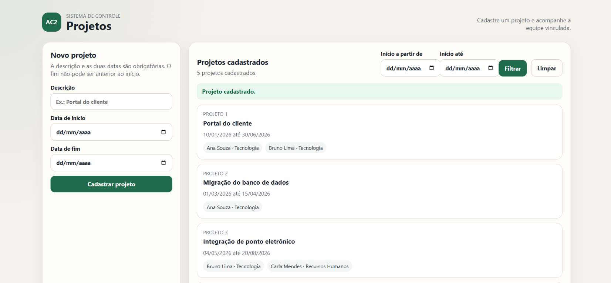

# Sistema de Controle de Projetos

Este projeto foi desenvolvido para a disciplina de Desenvolvimento Web Back-end com o objetivo de praticar a criação de uma aplicação web. O sistema permite cadastrar projetos, informar suas datas de início e fim e acompanhar os funcionários vinculados a cada projeto.

## Funcionalidades

- Cadastrar projetos com descrição e datas.
- Consultar os projetos cadastrados.
- Filtrar projetos pela data de início.
- Visualizar os funcionários associados aos projetos.

## Tecnologias utilizadas

- Java 21
- Spring Boot
- Spring Data JPA
- H2 Database
- HTML, CSS e JavaScript

## Como executar

É necessário ter o Java 21 e o Maven instalados. Na pasta do projeto, execute:

```bash
mvn spring-boot:run
```

Depois, acesse [http://localhost:8081](http://localhost:8080) no navegador.

## Tela do sistema


